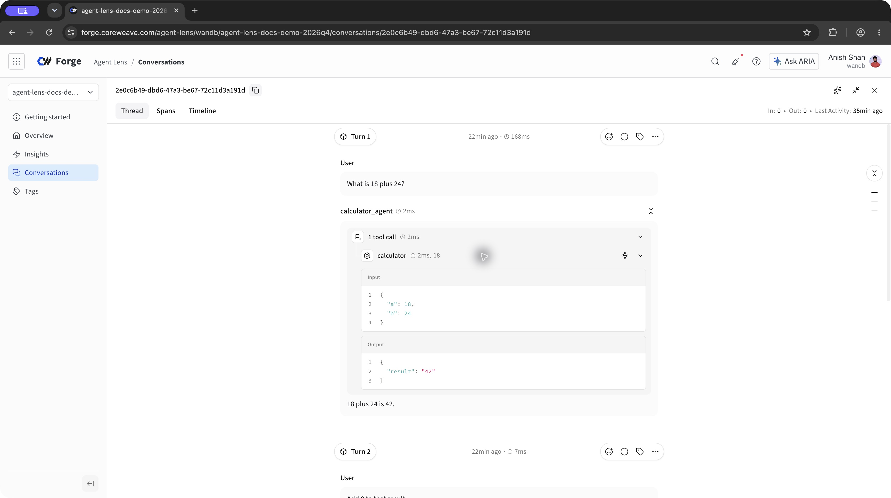

# Weave Integration Skill

AI coding agent skill for integrating [W&B Weave](https://docs.coreweave.com/products/wandb/weave) into existing applications — trace-first instrumentation with minimal code changes.

For supported agent conversations, start with the [Agent Lens integration chooser](https://docs.coreweave.com/products/agent-lens/get-started/integrations?utm_source=github&utm_medium=referral&utm_campaign=agent-lens-integrations-2026q4&utm_content=weave-integration-skills-readme). The skill selects the required SDK or plugin and verifies conversation grouping. The decorator workflow below applies to Weave Calls and evaluations.

## What It Does

Analyzes an existing codebase, creates a collaborative integration plan, and applies Weave tracing with user approval at every step.

- Scan for all functions, LLM calls, model classes, and frameworks
- Create `weave_instrumentation.md` with checkbox-based trace map
- AI pre-checks recommended targets, user opts out of what they don't need
- Two explicit approval gates before any code is modified

## How It Works
### Phase 0: Project Setup
- Confirm project name, environment, API key


### Phase 1: Codebase Analysis                     
- codebase-analysis.md
1. Scan for ALL functions, classes, API calls
2. Detect frameworks (FastAPI, LangChain, CrewAI, etc.)
3. Check if Weave is already partially integrated


### Phase 2: Plan File ⏸ APPROVAL GATE 1          
- weave-instrumentation-template.md
1. Ask: "Create weave_instrumentation.md?"
2. List ALL traceable targets with checkboxes
3. AI pre-checks [x] recommended, leaves [ ] others
4. User reviews and unchecks what they don't want


### Phase 3: Review ⏸ APPROVAL GATE 2
- Ask: "Approve this plan for implementation?"
- Do NOT proceed without explicit approval


### Phase 4: Apply Changes                         
- official docs + transformation-patterns.md
1. Follow the selected Agent Lens guide for agent conversations, including session grouping.
2. For Weave Calls, add weave.init() and decorate the checked functions with @weave.op().
3. Convert checked classes to weave.Model only where the approved evaluation or Calls plan requires it.


### Phase 5: Validation                           
- integration-checklist.md
1. Run integration checklist (setup, tracing, models, eval)
2. Guide user through test run + Weave UI verification
3. Ask if weave_instrumentation.md should be kept or deleted


### Result: Agent Lens workflow



Captured October 22, 2026 with ADK 2.12.0 and Weave 0.53.12. This example uses scripted model responses, real ADK tool execution, and real Agent Lens export. Use the matching integration guide to verify your application's turns and tools.

### Result: Weave Calls workflow


### Key principles
- **Trace first** — list everything, user opts out
- **Two approval gates** — plan creation and implementation are separate approvals
- **No code changes without explicit approval**

## Skill Structure

```
skills/weave-integration/
├── SKILL.md                                # Integration workflow, docs lookup, rules
├── evals/
│   └── evals.json                          # Test cases for skill trigger evaluation
└── references/
    ├── codebase-analysis.md                # Scan guide, evolve vs fresh logic, checkbox criteria
    ├── weave-instrumentation-template.md   # Template for weave_instrumentation.md plan file
    ├── transformation-patterns.md          # Model conversion patterns (class → weave.Model)
    └── integration-checklist.md            # Post-integration validation checklist
```

## Prerequisites

- Python 3.10+
- `pip install weave`
- `wandb login` or set `WANDB_API_KEY` environment variable

## Installation

```bash
# Clone the repo
git clone https://github.com/wandb/weave-integration-skills.git
cd weave-integration-skills

# Claude Code
cp -r skills/weave-integration/ ~/.claude/skills/weave-integration/

# Cursor
cp -r skills/weave-integration/ ~/.cursor/skills/weave-integration/

# Project-level (any agent)
cp -r skills/ .claude/skills/
```

## Example Prompts

- "Add Weave to my existing app"
- "Instrument my FastAPI app with Weave"
- "Integrate Weave into my LangChain project"
- "Add Weave to my OpenAI Agents SDK project"
- "Retrofit Weave tracing into my production chatbot"

## Documentation

- [W&B Weave](https://docs.coreweave.com/products/wandb/weave) — Product overview
- [Tracing](https://docs.coreweave.com/products/wandb/weave/guides/tracking/tracing) — LLM app tracing
- [Evaluation](https://docs.coreweave.com/products/wandb/weave/guides/core-types/evaluations) — Evaluation pipelines
- [Integrations](https://docs.coreweave.com/products/wandb/weave/guides/integrations/autopatching) — Provider & framework integrations

## License

MIT
